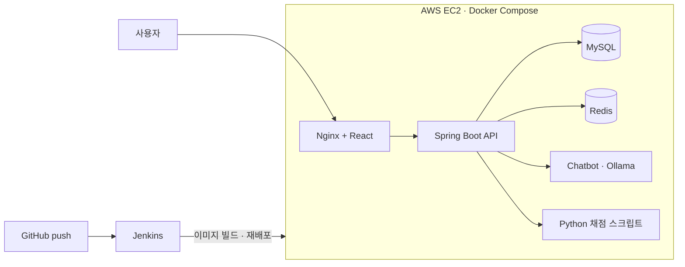
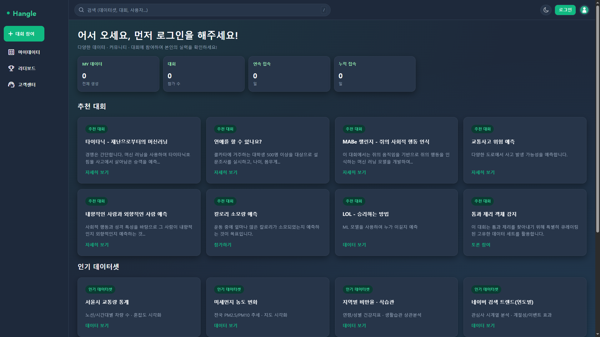
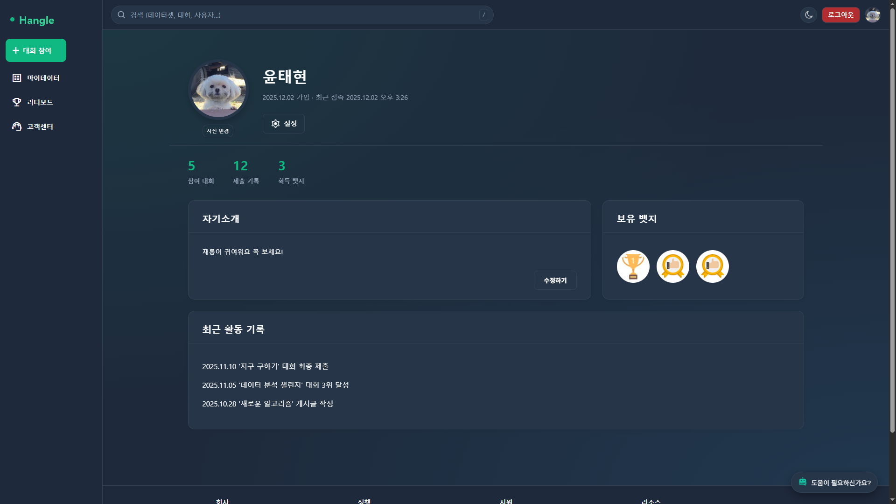
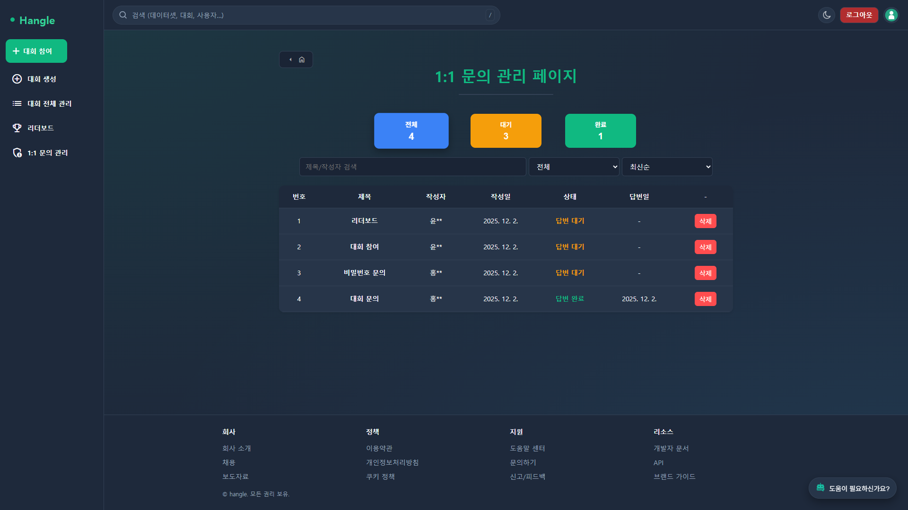
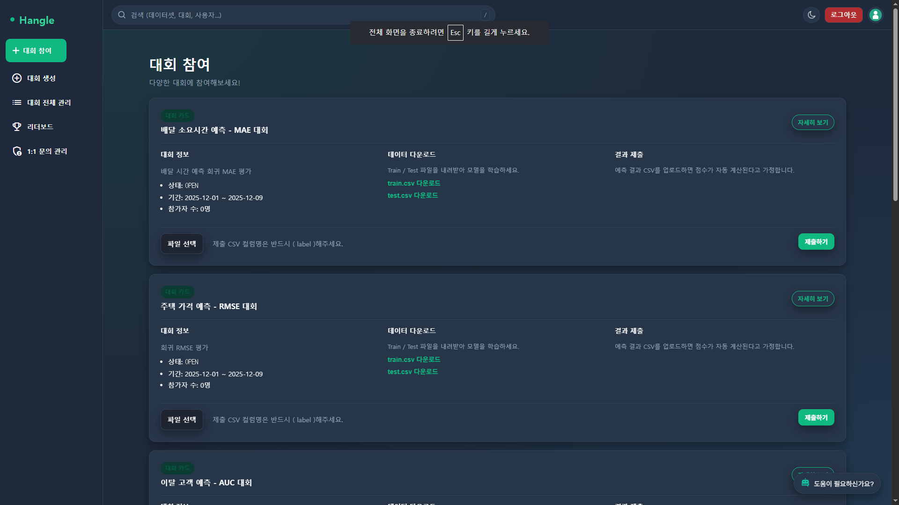
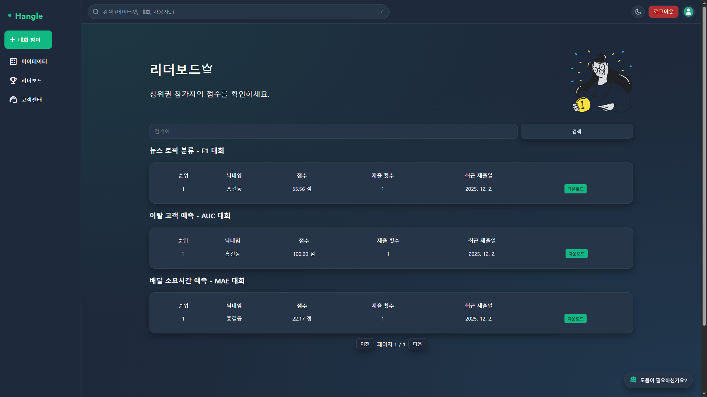

# Hangle – 머신러닝 데이터 대회 플랫폼

> CSV 제출 → Python 자동 채점 → 실시간 리더보드까지, 머신러닝 대회의 전 과정을 제공하는 웹 플랫폼입니다.
> 코리아IT아카데미 빅데이터UI 과정 5인 팀 프로젝트 · **2025.10 ~ 2025.12**

<p>


</p>

| 항목 | 내용 |
| --- | --- |
| 서비스 상태 | AWS EC2에 배포해 운영했으며, 프로젝트 종료 후 비용 문제로 서버를 내렸습니다. (로컬 실행: 아래 6번) |
| 시연 | [시연 영상](#) · [발표 자료](https://docs.google.com/presentation/d/e/2PACX-1vSg1h9NvZNjzSKujmwQxGmT5QqN6h0Y2nqCdztCroEf7TVdp_FwLXbFe5L9KzNstQ/pub?start=false&loop=false&delayms=3000) |
| 협업 | Jira 스프린트 · GitHub Projects 이슈 관리 · Notion 문서화 |

---

## 내 역할 — 윤태현 (팀장)

팀장으로 일정·이슈를 관리하고, 인증/보안 백엔드와 배포 인프라 전체를 맡았습니다.

| 영역 | 담당 |
| --- | --- |
| Backend | JWT 인증, Redis, 사용자 관리 & 권한 설정, 카카오 로그인, 휴대폰 인증 API, 챗봇(사용자/개발자 전용), Swagger 문서화 |
| Frontend | 로그인/회원가입, 마이프로필, 사용자 설정(정보 변경), 챗봇 UI |
| Infra | AWS EC2 설정, Docker 환경, Docker Compose, Jenkins 배포 자동화 |

### 트러블슈팅

**1. 팀원 중도 이탈로 생긴 업무 공백 (협업)**
- 문제: 개발 도중 팀원 1명이 이탈해 대회 목록 페이지 작업이 비었고, 다른 조보다 늦게 시작해 일정 여유도 없었습니다.
- 원인: 기능 단위로만 업무를 나눠 한 명이 빠지면 해당 기능 전체가 멈추는 구조였고, API 형식이 문서로 정리되지 않아 인수인계가 어려웠습니다.
- 해결: 팀장으로서 남은 작업을 Jira 이슈 4개로 잘게 나눠 담당자와 기한을 다시 정했습니다. 제가 맡은 Swagger 문서로 API 명세를 공유하고, GitHub 이슈 보드로 진행 현황을 매일 확인했습니다.
- 결과: 프론트·백엔드 간 요청 형식 확인이 줄었고, 일정 지연 없이 2025.12 최종 배포를 마쳤습니다.

**2. EC2 한 대에 컨테이너 5개를 올리며 생긴 메모리 부족 (인프라)**
- 문제: AWS 무료 크레딧 범위에서 운영하려고 소형 EC2(RAM 약 2GB) 한 대에 Nginx+React, Spring Boot, MySQL, Redis, Ollama 챗봇(gemma2:2b)을 Docker Compose로 함께 띄웠습니다. 챗봇 호출이나 배포 빌드가 겹치면 메모리가 한계에 닿아 컨테이너가 반복해서 종료됐습니다.
- 원인: 각 프로세스가 기본 설정대로 메모리를 잡았고, LLM 모델과 JVM 힙, MySQL 버퍼 풀이 동시에 올라가며 인스턴스 메모리를 넘겼습니다. Jenkins 배포 시 EC2에서 직접 React·Gradle 빌드를 돌린 것도 부담을 키웠습니다.
- 해결: 일주일(2025.11.24~12.01) 동안 서비스별 상한을 단계적으로 조정했습니다.
  - MySQL: 컨테이너 메모리 1GB 제한, `innodb-buffer-pool-size=256M`, `max-connections=50`, `table-open-cache=250`
  - Ollama: `OLLAMA_NUM_PARALLEL=1`로 동시 추론 1개로 제한
  - Spring Boot: `JAVA_TOOL_OPTIONS=-Xmx384m`로 힙 상한 지정
  - 안정성: `healthcheck` + `depends_on: service_healthy`로 기동 순서 고정, `restart: always`로 장애 시 자동 복구
- 결과: 평상시 메모리 사용률 75% → 43%로 낮췄고, 추가 비용 없이 단일 인스턴스에서 최종 발표까지 서비스를 운영했습니다.
- 개선한다면: 빌드는 Jenkins 서버에서 하고 EC2에는 완성된 이미지만 배포하거나, 챗봇을 별도 서버로 분리하겠습니다.

---

## 1. 프로젝트 소개 (Overview)
사용자의 머신러닝 모델 제출을 자동 채점하고, 실시간 리더보드에서 순위를 확인할 수 있는 ML Competition Platform입니다.
Spring Boot + React 기반으로 파일 업로드·대회 생성·채점·리더보드·고객센터·OAuth 로그인·AI 챗봇 등 서비스형 기능을 제공합니다.
관리자 페이지에서는 대회 생성/데이터셋 업로드/커스텀 채점 스크립트를 설정할 수 있습니다.

---

## 2. 개발 목적
- Spring Boot + React 기반의 풀스택 프로젝트 구축
- JWT 기반 인증/인가 적용 및 보안 아키텍처 학습
- 머신러닝 자동 채점 파이프라인 구현
- Docker + Jenkins로 CI/CD 자동화 구축
- 협업 중심의 프로젝트 경험 (GitHub / Jira / Notion)

---

## 3. 기술 스택 (Tech Stack)
| 구분 | 기술 |
| --- | --- |
| Frontend | React, JavaScript, SASS/SCSS, Axios |
| Backend | Spring Boot, Spring Security, JWT, Swagger(OpenAPI), Spring AI |
| Database & Cache | MySQL, Redis |
| DevOps | Docker, Docker Compose, Jenkins, Nginx, AWS EC2 |
| ML / Python | Python, Pandas, NumPy, Scikit-learn, Ollama |

---

## 4. 배포 구조 (Architecture)



---

## 5. 주요 기능 (Features)
| 구분 | 기능 |
| --------- | ----------------------------------------- |
| **회원 기능** | JWT 로그인, OAuth2(카카오/네이버/구글), 휴대폰 인증, 프로필 설정 |
| **대회 기능** | 대회 생성/수정/삭제, 상태 관리, 데이터셋 업로드 |
| **제출/채점** | CSV 제출, Python 자동 채점(F1/MAE/RMSE/AUC/ACC) |
| **리더보드**  | 상위권 자동 집계, 제출 횟수/점수/날짜 표시 |
| **고객센터**  | 1:1 문의 CRUD, 관리자 답변 기능 |
| **AI 챗봇** | Spring AI + Ollama, Swagger 기반 API 추천 |

---

## 6. 설치 및 실행 (Installation & Run)

### 1) 저장소 클론
```bash
git clone https://github.com/Doidoria/Hangle-PROJECT.git
cd Hangle-PROJECT
```

### 2) 설정값 준비
`BN/src/main/resources/application-*.properties`의 DB·OAuth·결제 키는 비워 두었습니다. 본인 값으로 채운 뒤 실행하세요.

### 3) Docker Compose로 전체 실행 (권장)
```bash
docker-compose -f docker-compose_local.yml up -d
```

### 4) 개별 실행
```bash
# 백엔드
cd BN && ./gradlew bootRun

# 프론트엔드
cd FN && npm install && npm start
```

---

## 7. 프로젝트 구조 (Project Structure)
```
Hangle-PROJECT
├── BN/            # Spring Boot 백엔드 (Dockerfile, src/main, src/test)
├── FN/            # React 프론트엔드 (Nginx 설정 포함)
│   └── src/
│       ├── api/         # AuthContext, axiosConfig
│       ├── components/  # ChatWidget, ProtectedRoute, PortOneCert ...
│       ├── pages/       # login, join, myProfile, setting, competition, leaderboard ...
│       └── css/
├── ML_Scripts/    # Python 채점 (accuracy, auc, f1, mae, rmse, custom)
├── CHATBOT/       # Ollama 챗봇 컨테이너
├── DB/ · REDIS/   # MySQL, Redis 컨테이너
├── JENKINS/       # Jenkins 이미지와 파이프라인
├── docker-compose.yml        # 운영(EC2)
└── docker-compose_local.yml  # 로컬
```

---

## 8. 화면 구성 (UI Preview)
| 메인 페이지 |
|--------------|
|  |
|  |
|  |
|  |
|  |

---

## 9. API 문서 (API Docs)
| Method | Endpoint | 설명 |
| ------ | ------------------------------- | ------------- |
| POST   | `/api/user/login`               | JWT 로그인 |
| POST   | `/api/auth/signup`              | 회원가입 |
| GET    | `/api/user/validate`            | 토큰 검증 |
| GET    | `/login/oauth2/code/{provider}` | OAuth2 로그인 콜백 |
| POST   | `/api/auth/logout`              | 로그아웃 |
| GET    | `/api/competitions`             | 대회 목록 조회 |
| GET    | `/api/competitions/{id}`        | 대회 상세 조회 |
| POST   | `/api/competitions`             | 대회 생성 (multipart/form-data) |
| PUT    | `/api/competitions/{id}`        | 대회 수정 |
| POST   | `/api/competitions/{competitionId}/submit` | CSV 제출 및 자동 채점 |
| GET    | `/api/leaderboard`              | 전체 리더보드 조회 |
| GET    | `/api/leaderboard?keyword=`     | 검색/필터링 |
| GET    | `/api/competitions/csv/{saveId}/download2` | 제출 CSV 다운로드 |
| GET    | `/api/competitions/{id}/download/{type}`   | Train/Test 데이터 다운로드 |
| GET    | `/api/leaderboard/top`          | 상위 TOP 제공 |
| POST   | `/api/inquiry`                  | 1:1 문의 등록 |
| GET    | `/api/inquiry/my`               | 내 문의 목록 |
| PUT    | `/api/inquiry/{id}`             | 내 문의 수정 |
| DELETE | `/api/inquiry/{id}`             | 내 문의 삭제 |
| GET    | `/api/inquiry/admin`            | 관리자 전체 문의 목록 조회 |
| POST   | `/api/v1/chat/dev`              | 개발자용 AI 챗봇 |
| POST   | `/api/v1/chat/user`             | 사용자용 챗봇 |
| GET    | `/api/chat/session`             | 챗봇 세션 조회 |
| DELETE | `/api/chat/session`             | 챗봇 세션 초기화 |
| GET    | `/api/chat/docs`                | Swagger API 기반 벡터 문서 검색 |

---

## 10. 개발 일정 (Timeline)
| 기간 | 주요 내용 |
|------|------------|
| 2025.10 | 기획 · 설계 · UI |
| 2025.11 | Spring Boot + MySQL 백엔드 구축, React 화면 구현, Docker 배포 + Jenkins CI/CD |
| 2025.12 | 최종 배포 테스트 및 발표 |

---

## 11. 팀 구성 (Contributors)
| 이름 | Frontend | Backend | Infra |
|------|------|------|------|
| **윤태현 (팀장)** | 로그인/회원가입, 마이프로필, 사용자 설정, 챗봇 UI | JWT 인증, Redis, 사용자 관리·권한, 카카오 로그인, 휴대폰 인증, 챗봇, Swagger | AWS EC2, Docker, Docker Compose, Jenkins |
| 전익환 | 고객센터(1:1 문의, 나의 문의 목록), 관리자 문의 확인·검색 | 1:1 문의 CRUD, 관리자 문의 관리 | |
| 서동성 | 메인페이지, 사용자·관리자 대회 페이지 UI | 대회 생성·조회·수정·삭제 | |
| 장지원 | 대회 페이지(유저, 상세) UI, 생성 페이지 파일 업로드 | 대회 파일 업로드, 제출·제출 파일 다운로드, 업로드 저장 경로 | |
| 이혜연 | 리더보드(검색, 필터링, 페이징) UI | 최고 점수 관리, 재제출 처리, 순위 재계산, 검색·필터링 | |

---

## 12. 회고 (Retrospective)
| 이름   | 느낀점 |
|---|---|
| 윤태현 | 저희 팀은 다른 조보다 늦게 프로젝트를 시작했지만, Jira로 이슈를 추적하고 Notion으로 정보를 공유하며 GitHub으로 버전 관리를 체계화해 서비스를 끝까지 배포할 수 있었습니다. 팀장으로서 팀원별 진행 상황을 자주 확인하고 막힌 부분을 함께 풀어가며 일정을 맞췄습니다. React의 컴포넌트 구조 덕분에 화면과 API 연동 로직을 분리해 유지보수가 쉬웠고, 배포 과정에서는 네트워크·보안 설정을 직접 다루며 안정적인 서비스 운영을 위한 인프라의 중요성을 배웠습니다. |
| 전익환 | 고객센터용 문의 기능을 구현하면서, 백엔드 요청 처리 과정에서 데이터 매핑 오류와 API 검증 실패 등 다양한 문제 때문에 작업을 진행하는 데 어려움이 있었습니다. 하지만 이러한 문제들은 오히려 코드를 더 꼼꼼하게 검토하고 고민함으로써 해결해 나갔고, 그 과정에서 철저한 API 설계와 디테일한 검증 절차의 중요성을 깨달을 수 있었습니다. |
| 서동성 | 저는 이번 프로젝트에 대해 부분을 많이 참여하지는 못했습니다. 대략 본인이 구현한 것이 아닌데도 그러나본인이 만든 파일을 작업하는 경우가 빈번하게 생성되는 이유로 인해, 파일 충돌이 많이 발생했습니다. 이렇듯 예상하지 못한 문제들이 많았습니다. 그래서 본인이 구현한 부분에 대해서 설명하고, 서로 소통하며 충돌을 줄여 나갔습니다. 팀 프로젝트에서 소통의 중요성을 많이 배웠습니다. |
| 장지원 | 프로젝트 초반 프론트엔드와 백엔드 간의 역할 분담이 되어 함께 작업했는데 프론트엔드 부분을 정확히 맞는 과정이 더욱 힘든 점을 느꼈다. 병합 과정에서 생긴미흡한 엘토로 같은 작은 문제들이 생겨, DTO/엔티티 불일치 등 작은 차이가 기능 오류상황에 큰 영향을 미쳐, 결국 서비스 동작에 문제가 생겼다. 이번 프로젝트로 정확한 역할에 대한 이해를 바탕으로 프론트 또는 백엔드간의 정확한 분담에 대해 고민해야겠다는 생각이 들었다. |
| 이혜연 | 프론트엔드 개발 도중 백엔드 데이터가 어떻게 흐름으로 가져 사용자가 화면에 반영되는지 파악할 수 있었습니다. 그로 인해 프론트와 백엔드가 서로의 구조를 밀접하게 고려하여 작업하는 것이 깨달게 되어, 다음 개발에는 구조 설계를 더 신경 써야겠다는 생각이 들었습니다. |

---

## 13. 라이선스 (License)
이 프로젝트는 MIT License 하에 배포됩니다.
